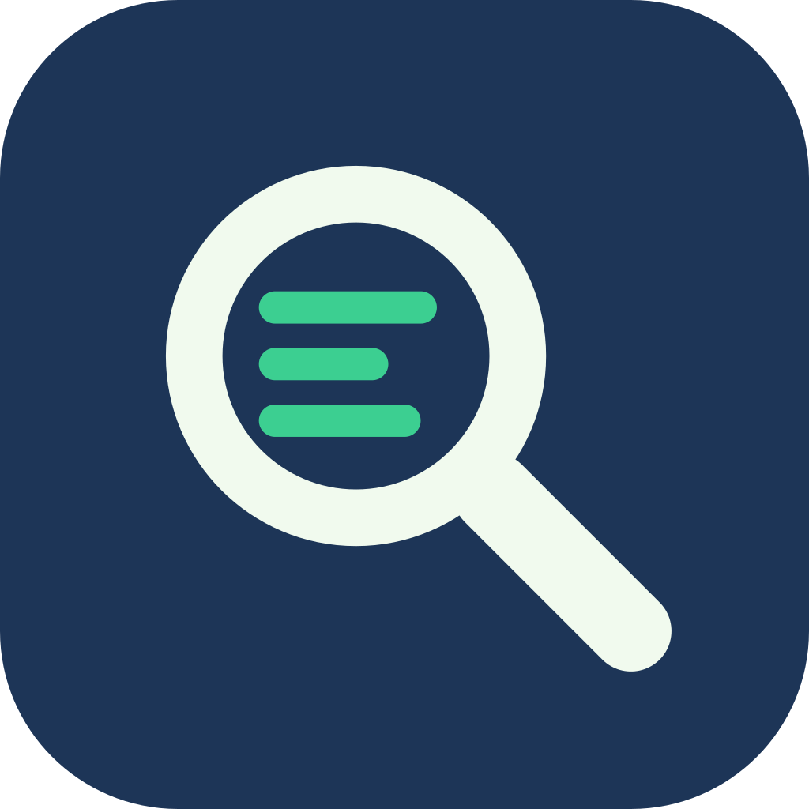
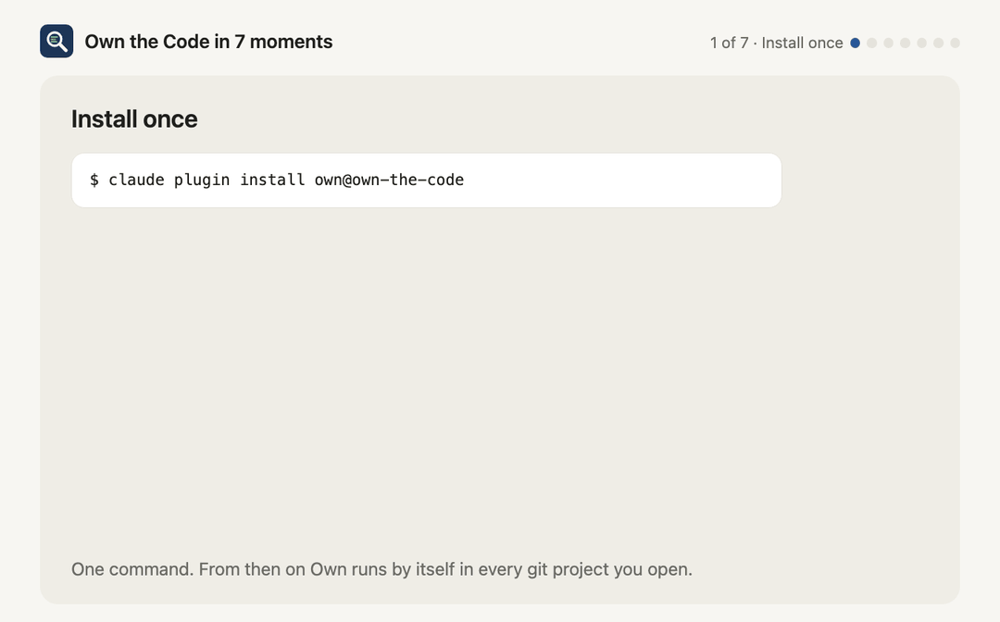
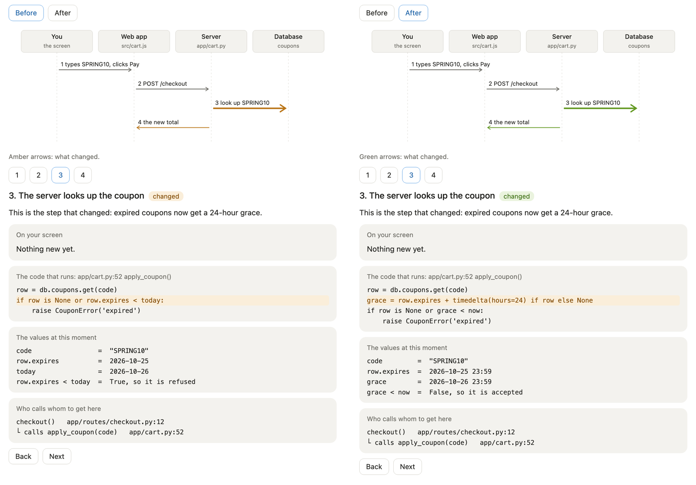
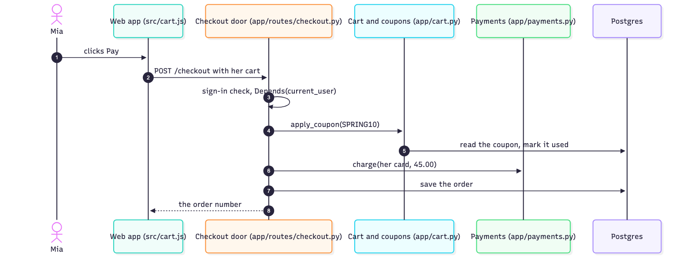
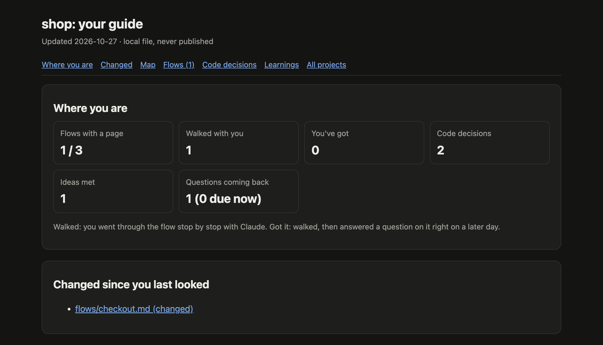

<p align="center">
  
</p>

<h1 align="center">Own the Code</h1>

<h3 align="center">A Claude Code plugin that keeps you the owner of the code Claude writes with you.</h3>

<p align="center">
  <a href="LICENSE"></a>
  <a href="https://github.com/swapnildhiman19/own-the-code/actions/workflows/tests.yml"></a>
  
  
</p>

<p align="center">
  <a href="#why-this-exists"><b>Why</b></a> ·
  <a href="#quick-start"><b>Quick start</b></a> ·
  <a href="#how-it-works"><b>How it works</b></a> ·
  <a href="#what-you-get"><b>What you get</b></a> ·
  <a href="#a-walk-up-close"><b>A walk, up close</b></a> ·
  <a href="#faq"><b>FAQ</b></a>
</p>

```bash
claude plugin marketplace add swapnildhiman19/own-the-code && claude plugin install own@own-the-code
```

<p align="center">
  
  <br><sub>Own in 7 moments, in a made-up shop app. It loops every 33 seconds.</sub>
</p>

## Why this exists

Maybe this sounds familiar:

1. **AI writes code faster than you can read it.** Every week there is a new model, a new tool, a new way to work.
   Keeping up feels like a second job.
2. **At first you review every change.** Then the changes get bigger, and you start skimming.
3. **Then you stop reading.** Claude asks "Shall I go ahead?" and you press Enter. Enter. Enter. The tests pass,
   the feature ships, and it feels productive.
4. **A month later** a teammate asks how checkout handles an expired coupon, or it breaks at 2 a.m., and you can't
   explain your own project without asking the AI first.
5. **Each week the gap grows**, catching up feels pointless, and you quietly give up. You feel behind and replaceable,
   even though you're shipping more than ever.

That gap has a name: *comprehension debt*, code that exists but that nobody understands. It isn't a lack of
talent or effort. It's what happens when code arrives faster than anyone can take it in, and nothing in the
workflow gives your understanding a chance to keep up.

The answer isn't to slow down or to stop using AI. It's to keep a small amount of **your own thinking** in the
loop, at the few moments where it pays off most. That's what Own does:

- **Claude keeps building at full speed.** Own keeps a private, plain-language guide to what was built and why,
  so you never have to read every change to know your project.
- **After a feature, two minutes are yours.** Walk through what changed, guess where the code goes next, explain it
  back in your own words, or say Later.
- **What you miss comes back** a few days later, until it sticks.
- **Your progress is honest.** A flow counts as yours only when you can still answer a question about it on a later
  day, not when you skimmed it once.

You don't need to understand every line. In practice, people who own a codebase know its 4 or 5 main paths deeply
and know where to look for the rest. Own builds exactly that, one walk at a time. You stay the person who can explain,
debug and change the code, and that is what keeps you relevant when AI writes most of it.

> Nothing is added to your repos. Building, pushing and deploying stay exactly as fast as before.

## Quick start

### Install

```bash
claude plugin marketplace add swapnildhiman19/own-the-code
```

```bash
claude plugin install own@own-the-code
```

You need Claude Code, `git` and `python3` (3.9 or newer), on macOS or Linux (Windows is untested). Own uses only
Python's standard library. Inside Claude
Code you can also type `/plugin marketplace add swapnildhiman19/own-the-code`, then `/plugin install own@own-the-code`.

### Try it

1. Open Claude Code in any git project you already have.
2. Type `/own:own map`. Claude reads the project and draws a map of its main parts and a list of its flows (a flow
   is one thing the app does, like "Checkout" or "Nightly export"). About 15 minutes.
3. Type `/own:own walk checkout` (use one of your own flows). Claude walks you through it stop by stop.
4. Build something as usual. When Claude finishes, it updates your guide and offers a 2-minute quiz.

### Optional setup

| You want | Do |
|---|---|
| Claude to call you by name, and compare new ideas to what you already know | `/own:own profile` |
| Pictures of the diagrams (the desktop app shows Mermaid diagrams as code) | `npm install -g @mermaid-js/mermaid-cli` |
| No permission prompts when Claude writes your guide | In `~/.claude/settings.json`: `"permissions": { "additionalDirectories": ["~/code-guides"] }` |
| To type `/own` instead of `/own:own` | `mkdir -p ~/.claude/skills/own && cp extras/own-shortcut/SKILL.md ~/.claude/skills/own/SKILL.md` (from a clone of this repo) |

Claude Code puts a plugin's name in front of its commands, so without the shortcut every command below starts with
`/own:own` instead of `/own`.

### Update and uninstall

```bash
claude plugin update own@own-the-code
```

```bash
claude plugin uninstall own@own-the-code
```

Your guides in `~/code-guides/` stay until you delete them.

## How it works

Own is a skill (instructions Claude loads when needed), three small hooks (scripts Claude Code runs at fixed
moments) and a command-line tool, `own-guide`, that keeps the numbers, dates and file fingerprints exact.

```mermaid
flowchart LR
    A[You open a project] -->|session-start hook| B[Claude gets a short note:<br>your guide, what's due today]
    B --> C[You plan as usual]
    C -->|first-edit hook: held once| S[Claude shows what will change,<br>asks your call, offers your line]
    S --> D[Claude builds]
    D --> E[Claude's turn ends]
    E -->|end-of-turn hook: enough code changed?| F[Claude updates the guide and shows<br>a Before / After code walk]
    F --> G[Quiz card: walk me through it,<br>start, later, or skip]
    G -->|your answers| H[Missed questions come back<br>after 1, 3, 7 and 21 days]
```



The first-edit hold happens once per piece of work, and small fixes go straight through. The end-of-turn check
fires once per set of changes, never in Plan mode, and never in the middle of building.

## What you get

**Automatically, in every git project:**

| When | What you see |
|---|---|
| You open a project | Nothing, unless something is waiting. Then, after Claude finishes your first request, one card a day at most: waiting questions · walk one flow · not today. |
| You open an existing project for the first time | "This project has no guide yet. Build the first map now (~15 min)?" |
| You plan | Every plan ends with "After this ships, you'll be able to answer:" and 3 questions. |
| Claude starts changing code | A code walk of the part it's about to change, with the steps that will change marked. At a real fork, **your call**. An offer to write **your line**, the 1-3 lines that carry the change. Every card can be handed back to Claude. |
| Claude builds | Nothing new for you. Claude jots down every choice the plan didn't settle. |
| A feature is done | A Before / After code walk of what changed, then which guide pages changed, then: "Quiz on <feature>: 3 questions, ~2 min" [Walk me through it first / Start / Later / Skip]. |
| You report a bug | In code you've walked: "Where would you look first?", and afterwards how close you were. In code you haven't seen: no guessing. Claude fixes it, then shows you the step that broke. |

**When you ask:**

| Command | What it does |
|---|---|
| `/own` | Your progress, then: quiz me, walk one flow, show my guide |
| `/own walk <flow>` | Walk one flow stop by stop (about 10 minutes) |
| `/own quiz` | A quiz on your latest work, plus questions that are due |
| `/own dashboard` | Your whole guide as one local page, with "Changed" badges |
| `/own map` | Build the first map of an existing project |
| `/own tour` | Pick a flow you haven't walked yet, and walk it |
| `/own explain <flow>` | One flow's page, or a walk through it |
| `/own progress` | Where you are, in five lines |
| `/own profile` | Your name, and what you already know well |
| `/own busy` | Short on time today: Claude makes the calls and writes the lines itself, and lists its calls for later |
| `/own off here` · `/own off` | Pause in this project · everywhere (`on` undoes it) |
| "let me write this part" | Claude leaves a 5-15 line gap for you, helps until the tests pass, then reviews it |

## A code walk, up close

You can't own code you've never seen, and you can't guess where a bug is in it either. So before asking you
anything, Own shows you. A code walk ties together, under one number per step, what's on your screen, the real
code that runs, the real values passing through it, and who calls whom to get there. It's like stepping through
with a debugger, with the variables panel open. Here's the step that changed when a shop gave expired coupons
24 more hours, before and after:

<p align="center">
  
</p>

It appears in the chat, and it's saved in your guide as `walks/<flow>.html`, so you can open it again any time.

**What makes it yours.** Watching isn't owning. People feel something is theirs when they know it closely, steer
it, and put some of themselves into it. So each change also brings, at most once each:

- **Your call**: at a real fork ("refuse an expired coupon, or give 24 more hours?"), Claude stops, recommends,
  and you decide.
- **Your line**: you write the 1-3 lines where the new behaviour lives, and Claude helps until the tests pass.
- **Find it yourself**: one thing you look up in your own editor ("who calls `apply_coupon()`?").

Each card has a "Claude handles it" answer, and `/own busy` hands them all to Claude for the day. Your progress
counts the calls you made and the code you wrote. Calls Claude made for you are listed on your guide page, to look
at later.

## A walk, up close

Reading a finished page feels clear, but it fades: whoever traces the code is the one who learns it. On a walk,
you do the tracing. Here is stop 2 of a 5-stop walk through a shop's checkout:

> **Route:** 1 Button → **[2 Door]** → 3 Coupon → 4 Payment → 5 Order
>
> **Stop 2 of 5: the door (arrows 2-3).** Mia's cart arrives at `app/routes/checkout.py:12` `checkout()`.
> `Depends(current_user)` runs before the function body: FastAPI checks her sign-in first.
>
> **Your guess:** *Mia used the coupon SPRING10. What happens before her card is charged?*
> (1) the order is saved · (2) the coupon is checked and marked used · (3) the cart is emptied · Not sure, show me

You answer, and Claude says plainly whether you were right, with the file and line that prove it. After the last
stop you explain the whole flow back in 2-3 sentences, and Claude points out what is missing. Then you see the
flow's picture. Its arrows carry the same numbers as the steps on the flow's page, so arrow 6 is always step 6:

<p align="center">
  
</p>

Own keeps the score honest. A flow counts as **walked** after a walk, and as **got** only once you answer a question
about it right on a *later* day. Gaps from your explanation come back as questions the next day.

## Where your guide lives

`/own dashboard` opens your whole guide as one page in your browser:

<p align="center">
  
</p>

Behind that page is one private folder on your computer:

```text
~/code-guides/                     your personal folder, never inside a repo
├── projects.json                  which repo belongs to which guide (one repo = one guide)
├── settings.json                  on/off, thresholds, your profile
├── dashboard.html                 all your projects on one local page
├── _knowledge/                    your knowledge book, shared by all projects
└── <project>/
    ├── FLOW.md                    the whole-project map and the list of flows
    ├── flows/<flow>.md            one page per flow, with numbered steps
    ├── diagrams/                  pictures of the diagrams
    ├── walks/<flow>.html          code walks: each step's screen, code, values and calls
    ├── CODE-DECISIONS.md          why the code is built this way
    ├── LEARNINGS.md               new ideas met in this project
    ├── guide.html                 generated: the whole guide as one page
    ├── PROGRESS.md                generated
    └── state.json                 quiz schedule and walks (managed by own-guide)
```

Worktrees of the same repo share one guide. A repo's identity comes from its GitHub address, so a renamed or
re-cloned folder keeps its guide.

## FAQ

**Does it slow Claude down?**
A little, and only where it buys you understanding. When Claude starts a real change, the first edit waits once
while Claude shows you what will change (a minute or two of Claude's work; small fixes skip it). Your call and your
line wait for you only if you take them. Guide updates and quizzes happen after the work is done, and you can
always say Later or Skip, or `/own busy` for a day. Nothing runs during a push or a deploy.

**Does my code leave my computer?**
Own itself sends nothing anywhere: it has no server. It reads your repo with `git` and writes only to
`~/code-guides/`. Claude reads and writes your guide like any other file in your session. See [SECURITY.md](SECURITY.md).

**Does it add files to my repo?**
Never. Your guides live in `~/code-guides/`, outside every repo.

**What does it cost in tokens?**
A short note at the start of each session in a git project, roughly 1,100 tokens. The skill's full instructions load
only when Own is actually used. Updating the guide after a feature takes a few minutes of Claude's work.

**Why multiple choice?**
Believable wrong answers make you think, and multiple choice is quick to answer between tasks. Every card also
takes a typed answer, and every walk ends with you explaining the flow in your own words. A tool, not Claude,
picks where the right answer goes, so it can't sit in the same place three times in a row.

**Can I turn it off?**
`/own off here` pauses it in one project, `/own off` everywhere. Turning the plugin off in Claude Code's plugin list
removes it completely; Claude Code is then exactly as before.

**Does it work in Plan mode, worktrees and monorepos?**
In Plan mode it stays silent, except that plans end with three "you'll be able to answer" questions. Worktrees share
their repo's guide. A monorepo is one guide whose map shows each app as a part.

## Why it works

- **The problem is real.** In a 2026 Anthropic study, 52 engineers learned a new Python library. Those coding with
  an AI assistant averaged 50% on the understanding quiz afterwards; those coding by hand averaged 67%. The AI users
  who generated code and then asked for explanations scored highest, about 86%; those who handed the work over
  scored about 39%. ([Anthropic research](https://www.anthropic.com/research/AI-assistance-coding-skills))
- **Tracing comes early.** Studies of novice programmers (Lister et al., 2004, and the work that followed) found
  that many can't reliably trace code by hand, and linked tracing skill to writing skill. Walks make you trace.
- **Explaining it back.** Saying in your own words how something works is one of the strongest ways to learn it
  (Chi et al., 1994). Every walk ends that way.
- **Retrieval, spaced out.** Answering a question with feedback beats re-reading, and answers stick longer when the
  questions come back after growing gaps (Little & Bjork 2012; Cepeda et al. 2008). Missed questions return after
  1, 3, 7 and 21 days.

## Development

```bash
python3 -m unittest discover -s tests -t tests
```

```bash
claude plugin validate plugins/own
```

`plugins/own/lib/own_guide/` is the `own-guide` tool, `plugins/own/skills/own/` is the skill and its references,
and `plugins/own/hooks/hooks.json` wires the two hooks. See [CONTRIBUTING.md](CONTRIBUTING.md) and
[CHANGELOG.md](CHANGELOG.md).

## License

[MIT](LICENSE).
